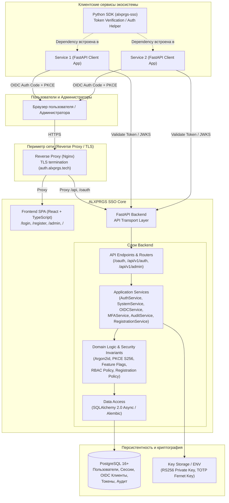
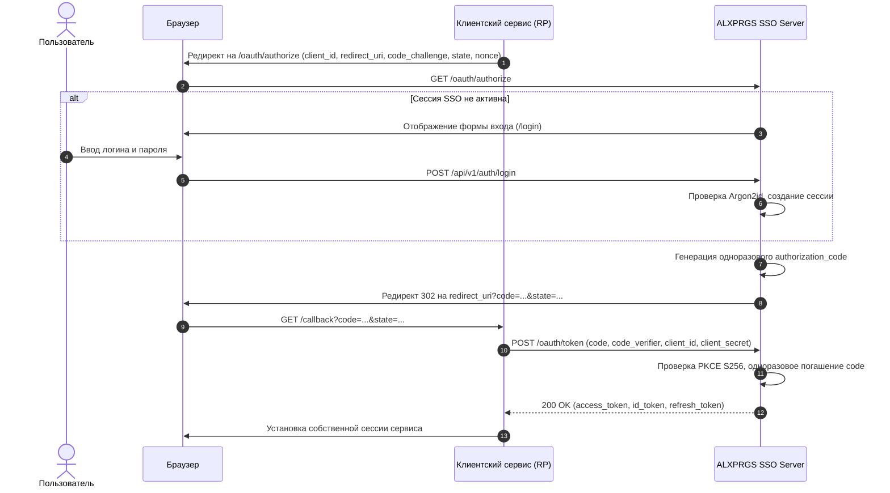

# Архитектура ALXPRGS SSO

Актуализация: 06.10.2026 (DOC-REFRESH-01). Дата первоначального утверждения ниже сохранена; [реестр и пределы сверки](index.md).

- Обозначение документа: ALXPRGS.SSO.ARCH-01
- Версия документа: 1.0.0
- Дата: 2026-09-24T11:38:00+03:00
- Статус: Утверждён

---

## 1. Введение и назначение системы

ALXPRGS SSO — централизованная закрытая система единого входа и управления идентификацией (Identity and Access Management / Single Sign-On) для доменной зоны `alxprgs.tech`. Система обеспечивает:
- Централизованную аутентификацию пользователей по логину и паролю (Argon2id).
- Выдачу токенов доступа и идентификации по протоколу OpenID Connect (OIDC Core 1.0) с поддержкой Authorization Code Flow и PKCE (RFC 7636).
- Интеграцию внешних сервисов экосистемы через стандартизированный протокол и отдельную клиентскую библиотеку Python SDK (`alxprgs-sso`).
- Поддержку расширенных факторов аутентификации (TOTP, WebAuthn Passkey, Recovery codes), отключённых по умолчанию, и обязательное подтверждение email перед созданием самостоятельно регистрируемого пользователя.
- Ролевое разграничение доступа (RBAC) и единый административный интерфейс.

---

## 2. Архитектурная схема компонентов

---

## 3. Модель разграничения сред и сессий

### 3.1. Браузерная сессия SSO (Кабинет и Аутентификация)
- **Механизм**: Серверные сессии PostgreSQL: cookie содержит случайный непрозрачный секрет, БД — SHA-256. Cookie не является подписанным JWT.
- **Флаги Cookie в production**: `Secure=true`, `HttpOnly=true`, `SameSite=Lax`, `Path=/`, без указания атрибута `Domain` (Host-Only cookie). Это предотвращает утечку cookie на соседние поддомены `*.alxprgs.tech`.
- **Защита от CSRF**: Заголовок `X-CSRF-Token` с HMAC от UUID сессии и серверного ключа, плюс exact Origin для всех мутирующих запросов (POST, PUT, DELETE, PATCH).
- **Срок жизни**:
  - Idle timeout: 12 часов неактивности.
  - Absolute timeout: 7 суток с момента создания.

### 3.2. Токены API и OIDC
- **Access Token**: JWT асимметричной подписи RS256, срок действия 5 минут (300 секунд).
  - Claims включают iss/sub/aud/exp/nbf/iat/jti/scope/token_use и security_revision; roles выдаются только при profile scope.
- **ID Token**: JWT асимметричной подписи RS256, срок действия 5 минут. Выдаётся клиенту вместе с access token при запросе scope `openid`.
  - Claims: `iss`, `sub`, `aud`, `exp`, `iat`, `nonce` (если был передан), `auth_time`, `token_use`; `email/email_verified` только при email scope, `preferred_username/roles` только при profile scope.
- **Authorization Code**: 60 секунд, одноразовый (single-use), привязан к `client_id`, `redirect_uri`, `code_challenge` (S256), `nonce`.
- **Refresh Token**: Ротируемый токен, срок жизни 7 дней. При каждом обмене старый токен отзывается, выпускается новый. При попытке повторного использования старого токена (Replay Attack) автоматически отзывается всё семейство токенов (Token Family).

---

## 4. Потоки OpenID Connect и Single Sign-On

### 4.1. Авторизация (Authorization Code Flow with PKCE)

### 4.2. Бесшовный вход во второй сервис (SSO Single Sign-On)
1. Пользователь обращается к Сервису 2.
2. Сервис 2 направляет браузер на `/oauth/authorize`.
3. Запрос содержит Host-Only cookie сессии SSO.
4. Сервер SSO валидирует сессию: пользователь уже аутентифицирован.
5. Сервер SSO моментально генерирует `authorization_code` для Сервиса 2 и возвращает 302 редирект на Сервис 2 без запроса пароля.
6. Сервис 2 производит обмен кода на токены.

---

## 5. MFA default-on, session assurance и feature flags

TOTP, Passkey и Recovery codes доступны по умолчанию; email-параметр сохранён для совместимости. Отсутствие переменных включает функции, явный `false` — аварийное отключение:
- `FEATURE_TOTP_ENABLED` (по умолчанию `true`)
- `FEATURE_PASSKEY_ENABLED` (по умолчанию `true`)
- `FEATURE_RECOVERY_CODES_ENABLED` (по умолчанию `true`)
- `REQUIRE_ADMIN_MFA` (по умолчанию `true`)
- `FEATURE_EMAIL_VERIFICATION_ENABLED` (совместимый параметр; всегда `true`, значение `false` отвергается)

### Архитектурные инварианты:
1. **Single Source of Truth**: Сервер является единственным источником правды.
2. **Fail-Closed**: При выключенном флаге:
   - Роуты TOTP, Passkey и Recovery codes возвращают `404 Not Found` с кодом `feature_disabled`; подтверждение email доступно и необходимо для самостоятельной регистрации.
   - Закрытый режим самостоятельной регистрации не создаёт заявку и не отправляет письмо.
3. **Безопасная витрина возможностей (Capabilities)**: `/api/v1/auth/capabilities` возвращает доступность MFA, `admin_mfa_required` и режим регистрации. Фронтенд использует эти данные, но не принимает решений безопасности.
4. **Защита от bypass**: если у пользователя уже есть подтверждённый фактор, а runtime-флаг отключён, вход не пропускается по одному паролю. Администратор без подтверждённого фактора получает только onboarding-сессию; порождённые до изменения сессии не получают assurance автоматически.

### Session assurance и административный доступ

`Session` хранит `mfa_verified`, `mfa_method`, `mfa_verified_at` и `amr`. Значения пишет только сервер после реальной проверки TOTP/Passkey/Recovery; клиент не может передать их в login/API. Парольный вход создаёт `mfa_verified=false`. Администратор без активного фактора получает `purpose=admin_mfa_enrollment`: разрешены только `me/logout/legal`, настройка TOTP/Passkey, управление собственными passkey, reauthentication и `POST /api/v1/auth/session/elevate`. После настройки фактор подтверждается fresh proof в этой же сессии; при успехе `purpose=full`, `mfa_verified=true`. Подтверждение одной сессии не наследуется другой, `auth_time` сам по себе не является доказательством, а изменение/удаление фактора очищает assurance сохранённой сессии и отзывает остальные.

Административные API проверяют одновременно живую сессию, RBAC и assurance. `require_admin_user` не пропускает `is_superuser`/`role=admin` при `mfa_verified=false`. OIDC authorization code/refresh token хранят assurance snapshot (`mfa_verified`, `amr`); access/ID tokens получают `amr`/`acr`, а роль `admin` не выдаётся grant, созданному без обязательного assurance. Старые grants после миграции имеют `false` и не могут получить admin-роль при refresh; UserInfo также фильтрует admin по assurance токена. Подробности — [ADR-0032](adr/0032-default-on-mfa-and-admin-policy.md), [security](security.md).

Для самостоятельной регистрации `RegistrationService.start` создаёт `pending_registrations`, не `users`. `confirm` под блокировкой строки проверяет шестизначный HMAC-код либо хеш одноразовой ссылки и атомарно создаёт подтверждённого пользователя. `EmailVerificationService` сохраняет прежний путь для уже существующих пользователей. Общий MIME-шаблон `services/verification_email.py` содержит text/AMP/HTML и отправляется через SMTP либо SES API v2 Raw (`services/ses_email.py`) согласно `EMAIL_PROVIDER`. Сырой код и токен попадают в in-memory sink только при `ENVIRONMENT=testing`. Ссылка `/verify-email` погашается действием пользователя. Подробнее: [ADR-0007](adr/0007-ses-email-provider.md), [ADR-0008](adr/0008-registration-after-email-verification.md).

## Sentry (ADR-0010)

При включённой диагностике FastAPI и React отправляют application errors в отдельные проекты EU; shared immutable VERSION/SHA release. Runtime browser config не обращается к PostgreSQL и не содержит backend DSN/credentials/user data. Transaction/static mode позволяет очищать complete traces; outgoing backend propagation выключена, browser ограничен same-origin API/OAuth. Security audit остаётся PostgreSQL, stdout использует безопасный JSON formatter. Replay — отдельный staging-only chunk/worker; все чувствительные views blocked. Private maps отделены от deploy output, token доступен единственному trusted release step. Подробности и ограничения: [observability.md](observability.md).

## Третий email transport — Resend

По EMAIL-RESEND-01 существующий verification_email dispatcher поддерживает native Resend через отдельный async HTTPX adapter. Settings/ошибка доставки/API сценарии прежние; selector smtp(default)/ses/resend. Resend использует RESEND_API_KEY и SMTP_FROM_EMAIL/ALXPRGS, передаёт text/HTML, без AMP, retry/fallback/queue/webhooks. SES raw MIME, boto3 credentials/retry и SMTP MIME/verified STARTTLS сохранены. finite provider allowlists в аудите и Sentry дополнены resend без снятия scrubbing. См. [ADR 0020](adr/0020-resend-email-provider.md), [приёмка](https://github.com/alxprgstech/sso/blob/3603d5721938f594d7892c8c33ba33912906bcb4/docs/acceptance-resend.md).

## Границы реализации

Authlib используется для scope/PKCE helpers; API/OIDCService реализуют HTTP-профиль и транзакционные grants; JWT — PyJWT/cryptography. Наличие Authlib не означает готовый AuthorizationServer или сертификацию. Compose — локальный HTTP на loopback, HTTPS-схема выше описывает целевую топологию. [API](api.md), [status](status.md).

Claims email/email_verified выдаются только при email scope, preferred_username/roles — при profile. Access/ID Token включают `amr` (`pwd`, `otp`, `hwk`, `mfa`) и `acr` (`urn:alxprgs:acr:pwd`/`urn:alxprgs:acr:mfa`); admin-роль фильтруется по assurance snapshot. ID Token включает token_use/id-профиль и auth_time; полный контракт описан в API. Бесшовный вход возможен только при допустимой OP session и отсутствии требования fresh login/согласий/смены пароля/удаления; prompt=login/none и max_age соблюдаются.

## Cross-application transaction step-up

В 0.3.0 добавлен отдельный opt-in слой поверх существующего OIDC/SSO: RP backend создаёт transaction challenge, браузер проходит hosted password/TOTP/Passkey flow на SSO origin, а RP backend погашает одноразовый code и получает `external_step_up_proof` JWT. Client registry/authentication, redirect URI, PKCE, state/nonce, issuer/JWKS и session/security-revision validation переиспользуются; внутренний `X-Reauthentication` не открывается внешним клиентам. PostgreSQL `external_step_up_requests` обеспечивает binding и атомарное одноразовое погашение. Подробности, варианты и границы — [ADR-0031](adr/0031-external-transaction-step-up.md), [API](api.md), [SDK](sdk.md).

## Выделенный EC2 (DEPLOY-EC2-01)
По решению владельца 25.10.2026 подготовлен отдельный production-контур: [ADR-0029](adr/0029-ec2-continuous-deployment.md), [эксплуатация](ec2-deployment.md). Host nginx — единственный TLS gateway; static React из проверенного frontend image, API на loopback8000, private PostgreSQL. Локальная topology выше сохраняется для разработки. Live-развёртывание требует действий владельца.
